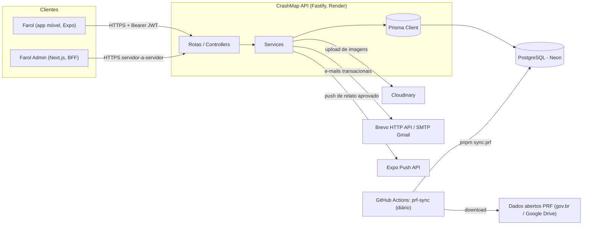
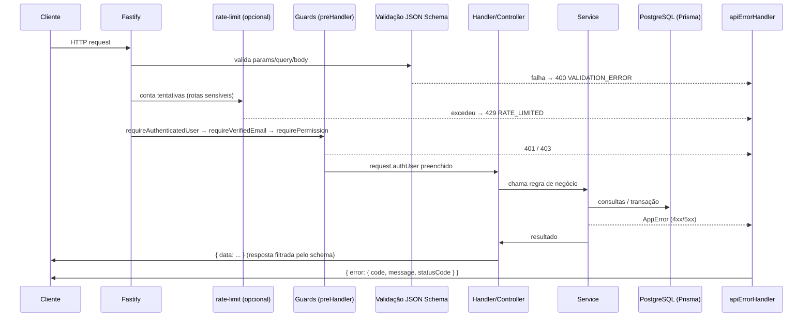
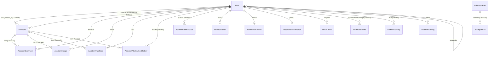
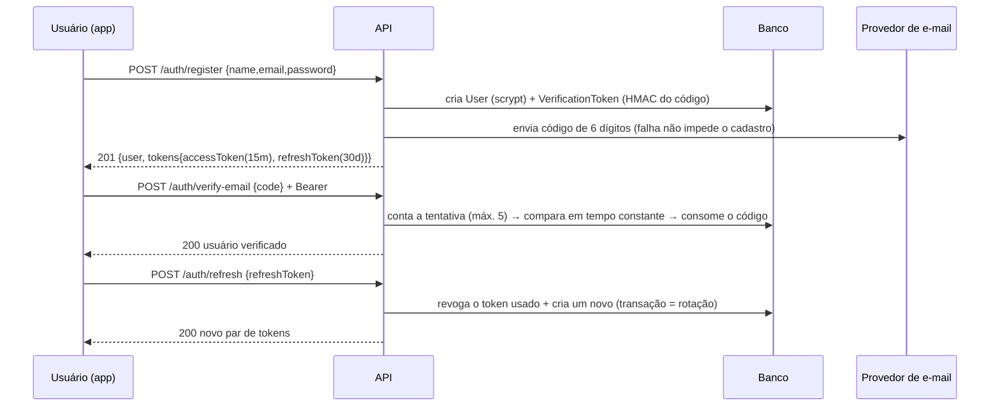
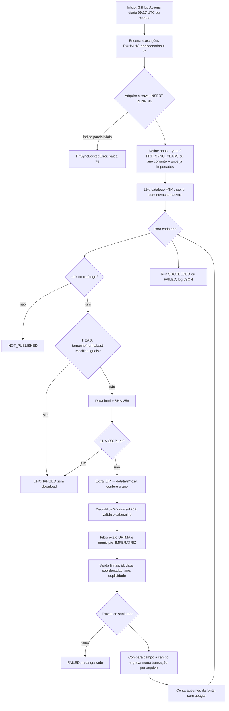
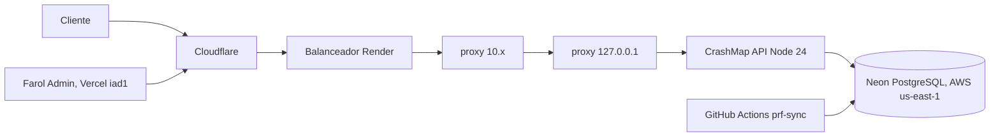

# Relatório Técnico — CrashMap API (ecossistema Farol)

> Documento de apoio à monografia de TCC (IFMA). Descreve **exclusivamente** o repositório `crashmap-api`, o backend do ecossistema Farol. Não é a monografia nem um tutorial de instalação.
>
> **Data da análise:** 14/11/2026 · **Branch analisada:** `development` (commit `c51004a`) · **Método:** leitura estática integral do código-fonte, das migrações, dos testes, da documentação e dos arquivos de configuração, mais a execução de verificações sem efeitos colaterais (seção 12.1).

## Convenção de rastreabilidade

Cada afirmação relevante recebe uma das etiquetas abaixo:

| Etiqueta | Significado |
|---|---|
| **[Implementado]** | Confirmado pela leitura do código-fonte (arquivo e símbolo indicados). |
| **[Verificado]** | Confirmado por uma execução feita **nesta análise** (seção 12.1). |
| **[Documentado como verificado]** | O repositório registra uma verificação (em `docs/`), mas ela **não foi reexecutada** nesta análise. Use como evidência de terceiros, com a data indicada no documento. |
| **[Planejado]** | Proposta ou trabalho futuro registrado no repositório, sem implementação. |
| **[Não verificável]** | Não pôde ser comprovado com os materiais disponíveis. |

Os caminhos de arquivo são relativos à raiz do repositório. Nenhuma credencial é reproduzida neste documento.

---

## 1. Identificação e visão geral do projeto

| Item | Valor | Evidência |
|---|---|---|
| Nome do pacote | `crashmap-api` v1.0.0 | `package.json` |
| Papel no ecossistema | Backend HTTP (API REST/JSON) do Farol | `src/app.ts`, `docs/DEPLOY.md` |
| Linguagem | TypeScript 5.8.3 (modo `strict`), ESM | `package.json`, `tsconfig.json` |
| Runtime | Node.js 24 | `.node-version` |
| Banco de dados | PostgreSQL, via Prisma ORM 6.19.0 | `prisma/schema.prisma` |
| Histórico Git | 62 commits, de 04/07/2026 a 14/11/2026 | `git log` |
| Tamanho aproximado | ~120 arquivos `.ts` em `src/`, 24 arquivos de teste, 21 migrações | `git ls-files` |
| Contrato da API | 59 operações HTTP documentadas em OpenAPI 3.0 | `tests/__snapshots__/api-contract.json` |

A CrashMap API recebe, valida, persiste e disponibiliza as ocorrências de acidentes de trânsito de Imperatriz–MA. Há duas origens de dados: **relatos colaborativos** enviados pelo aplicativo móvel Farol (`source = APP`), que passam por moderação humana, e **registros oficiais da Polícia Rodoviária Federal** (`source = PRF`), importados automaticamente dos dados abertos e publicados sem moderação. A API também cuida das contas, da autenticação, do controle de acesso por papéis, da moderação, da auditoria administrativa, dos avisos, das notificações push e da gestão da equipe de moderadores usada pelo painel Farol Admin.



---

## 2. Objetivos e responsabilidades do sistema

Com base no código, a API tem estas responsabilidades **[Implementado]**:

1. **Gerenciar identidades:** cadastro, login, sessões renováveis, verificação de e-mail, recuperação de senha, edição e exclusão da própria conta (`src/modules/auth`, `src/modules/users`).
2. **Receber relatos colaborativos** georreferenciados e mantê-los privados até a aprovação (`accidents.service.ts#createAccident`, `accident-moderation.service.ts`).
3. **Publicar dados para visualização espacial:** mapa leve com filtros, versão do mapa para cache no cliente e estatísticas públicas (`listAccidentsForMap`, `getAccidentsMapVersion`, `getAccidentOverview`).
4. **Integrar dados oficiais da PRF**, filtrados para Imperatriz–MA, com detecção de mudança e histórico de execuções (`src/modules/prf-sync`).
5. **Dar suporte à moderação e à governança:** fila de moderação, decisões atômicas, histórico somente-inserção, auditoria administrativa, gestão de usuários e de equipe (`src/modules/accidents/accident-moderation.*`, `moderation`, `audit`, `team`, `users/users-admin.*`, `settings`).
6. **Permitir engajamento comunitário:** comentários, imagens e votos de confiança em relatos aprovados, com indicadores de "gamificação" do usuário (`accident-comments.*`, `accident-images.*`, `accident-trust.*`, `users.service.ts#getMyGamificationStats`).
7. **Comunicar:** avisos administrativos e notificação push quando um relato é aprovado (`src/modules/notifications`).

O que o repositório **não** comprova: o impacto do sistema na redução de acidentes ou na formulação de políticas públicas **[Não verificável]**. Essas são aplicações possíveis, que exigiriam avaliação específica.

---

## 3. Tecnologias e ferramentas utilizadas

### 3.1 Dependências de produção (`package.json`)

| Dependência | Versão | Uso confirmado no código |
|---|---|---|
| `fastify` | ^5.8.5 | Servidor HTTP, plugins, hooks e validação por JSON Schema (`src/app.ts`) |
| `@fastify/cors` | ^11.3.0 | CORS por lista de origens (`app.ts`, `env.ts#readCorsOrigins`) |
| `@fastify/rate-limit` | 10.3.0 | Limite de tentativas por rota sensível (`shared/http/rate-limits.ts`) |
| `@fastify/multipart` | ^10.1.0 | Upload de imagens, até 10 MB (`app.ts`, `accident-images.controller.ts`) |
| `@fastify/swagger` / `@fastify/swagger-ui` | ^9.8.1 / ^6.1.1 | Documento OpenAPI 3.0 e interface em `/docs` (`shared/http/api-docs.ts`) |
| `prisma` / `@prisma/client` | 6.19.0 | ORM, migrações e cliente gerado em `generated/prisma` |
| `cloudinary` | ^2.10.0 | Armazenamento de imagens (`shared/services/storage/cloudinary.ts`) |
| `nodemailer` | ^10.5.0 | Envio SMTP (Gmail) (`shared/services/mail/mailer.ts`) |
| `csv-parser` | ^3.2.1 | Leitura do CSV da PRF (`prf-sync/prf-csv.ts`) |
| `unzipper` | ^0.12.5 | Extração do ZIP da PRF (`prf-sync/prf-source.ts`) |
| `dotenv` | ^16.6.1 | Carga de variáveis de ambiente (`shared/config/env.ts`) |

**Desenvolvimento:** `typescript` 5.8.3, `tsx` (execução e *watch*), `@types/*`. **Testes:** o executor nativo do Node (`node --test`), sem framework externo. **Gerenciador de pacotes:** pnpm 10.7.0.

### 3.2 Recursos nativos usados no lugar de bibliotecas

- **JWT feito no próprio código:** a assinatura e a verificação HS256 usam `node:crypto` (`createHmac`, `timingSafeEqual`), sem biblioteca JWT (`src/modules/auth/tokens.ts`) **[Implementado]**.
- **Hash de senha com scrypt** (`node:crypto.scryptSync`), sal de 16 bytes e chave de 64 bytes (`src/modules/auth/password.ts`) **[Implementado]**.
- **Requisições HTTP de saída** com `fetch` nativo (Expo Push, Brevo, PRF) **[Implementado]**.
- **Decodificação Windows-1252** com o `TextDecoder` nativo (`prf-csv.ts`) **[Implementado]**.

### 3.3 Infraestrutura e serviços externos

| Serviço | Papel | Evidência |
|---|---|---|
| Render (Web Service, plano gratuito) | Hospedagem da API | `render.yaml`, `docs/DEPLOY.md` |
| Neon (PostgreSQL gerenciado) | Banco de produção | `docs/DEPLOY.md` |
| GitHub Actions | Agendamento da sincronização PRF | `.github/workflows/prf-sync.yml` |
| Cloudinary | Imagens dos relatos | `cloudinary.ts` |
| Brevo (API HTTP) ou Gmail (SMTP) | E-mails transacionais | `mailer.ts` |
| Expo Push API | Notificações push | `notifications.service.ts` |

**Observação:** `docs/ARCHITETURE.MD` cita "geolocalização utilizando PostGIS", mas o código não usa PostGIS. As coordenadas são colunas `Float` (`latitude`, `longitude`) e os filtros espaciais são retângulos de latitude/longitude (`accidents.filters.ts`). PostGIS deve ser tratado como **[Planejado]**, não como implementado.

---

## 4. Arquitetura de software

### 4.1 Estilo arquitetural

A API é um **monólito modular organizado por funcionalidade** (*feature-first*), com uma área `shared` para recursos transversais. A justificativa está registrada em `docs/ARCHITETURE.MD` (seção "Por que escolhemos essa arquitetura?"): uma organização só por tipo de arquivo (`controllers/`, `services/`) espalharia o código de domínios como autenticação, acidentes, moderação e PRF por muitas pastas.

Dentro de cada módulo há uma separação em camadas **[Implementado]**:

| Camada | Arquivo típico | Responsabilidade |
|---|---|---|
| Rota/Controller | `*.controller.ts` | Plugin Fastify: método, caminho, *guards* (`preHandler`), schema e *handler* que delega ao service |
| Schema | `*.schema.ts` | JSON Schema que valida a entrada, filtra a resposta e gera o OpenAPI |
| Service | `*.service.ts` | Regras de negócio e acesso ao banco via Prisma |
| Auxiliares | `*.mapper.ts`, `*.filters.ts`, `*.access.ts`, `*.errors.ts` | Conversão registro→resposta, trechos de `where`, regras de acesso, erros do domínio |
| Tipos | `*.types.ts` | Tipos TypeScript do módulo |

O documento de arquitetura determina que **o controller nunca acessa o Prisma diretamente**. Na amostra inspecionada (controllers de `accidents`, `auth`, `users`, `team`, `notifications`, `admin`), os controllers só importam services, schemas e *guards*.

### 4.2 Composição da aplicação

`src/app.ts#buildApp` monta a aplicação nesta ordem **[Implementado]**:

1. Instância Fastify com `logger: true` e `trustProxy` configurável (`env.TRUST_PROXY`).
2. `@fastify/rate-limit` com `global: false`, aplicado no *hook* `preHandler`, para que o limite de login use o e-mail já lido do corpo.
3. Documentação OpenAPI e Swagger UI (`/docs`).
4. CORS restrito a `env.CORS_ORIGINS`.
5. Multipart com limite de 10 MB por arquivo.
6. Tratador global de erros (`apiErrorHandler`).
7. Plugins de rota com prefixos: `/auth`, `/users`, `/admin`, `/moderator-invites`, `/notifications`, `/accidents` e `/health`.
8. *Hook* `onClose` que desconecta o Prisma.

`src/server.ts` conecta o Prisma, escuta em `0.0.0.0:PORT` (padrão 3333) e encerra de forma ordenada em `SIGINT`/`SIGTERM`.

### 4.3 Fluxo de uma requisição



### 4.4 Padrão "nega por padrão" do painel

`src/modules/admin/admin.plugin.ts#adminPlugin` agrupa as rotas `/admin/*` e registra um *hook* `onRoute`. Toda rota declarada nesse escopo **precisa** ter `config.permission`; sem ela, a API **lança erro ao iniciar** ("Rota administrativa sem permissão declarada"). O *hook* também antepõe a cadeia `staff(permission)` aos `preHandler` da própria rota **[Implementado]**. É uma garantia estrutural de que nenhuma rota administrativa nova fica sem controle de acesso por esquecimento.

---

## 5. Organização do código-fonte

```text
crashmap-api/
├── src/
│   ├── app.ts / server.ts            composição e inicialização
│   ├── modules/
│   │   ├── accidents/   15 arquivos  relatos, mapa, estatísticas, moderação, comentários, imagens, confiança
│   │   ├── admin/                    plugin /admin (nega por padrão)
│   │   ├── audit/                    gravação e consulta da auditoria administrativa
│   │   ├── auth/        14 arquivos  cadastro, login, JWT, sessões, verificação de e-mail, recuperação de senha, permissões
│   │   ├── health/                   GET /health
│   │   ├── moderation/               histórico de decisões de moderação
│   │   ├── notifications/            avisos administrativos e push (Expo)
│   │   ├── prf-sync/                 sincronização dos dados abertos da PRF
│   │   ├── settings/                 configurações da plataforma (chave/valor)
│   │   ├── team/                     convites e equipe de moderação
│   │   └── users/                    conta própria, gestão de contas (admin), script de papéis
│   ├── shared/
│   │   ├── config/env.ts             leitura e validação do ambiente
│   │   ├── database/prisma.ts        instância única do PrismaClient
│   │   ├── errors/app-error.ts       AppError(message, statusCode, code)
│   │   ├── http/                     envelope de resposta, paginação, erros, limites, OpenAPI
│   │   ├── security/crypto.ts        HMAC-SHA256, SHA-256, código de 6 dígitos
│   │   ├── services/                 mail (Brevo/SMTP), storage (Cloudinary)
│   │   ├── utils/                    datas UTC, e-mail, escape de HTML
│   │   └── scripts/                  CLIs: sync-prf, import-prf, grant-role
│   └── types/                        extensões de tipos do Fastify (authUser, config.permission)
├── prisma/schema.prisma + migrations/ (21 migrações)
├── tests/ (24 arquivos *.test.ts + snapshot do contrato + helpers)
├── docs/ ARCHITETURE.MD, DEPLOY.md, PRF_SYNC.md
├── render.yaml                       blueprint de implantação
└── .github/workflows/prf-sync.yml    agendamento da sincronização PRF
```

O módulo `accidents`, o maior, é dividido **por assunto e não por camada**: há um controller e um service para cada sub-recurso (moderação, comentários, imagens, confiança), e `accidents.controller.ts` só os registra numa ordem fixa, que define a ordem das rotas na documentação.

---

## 6. Modelagem e gerenciamento de dados

### 6.1 Entidades (`prisma/schema.prisma`)



| Entidade | Finalidade | Campos e restrições relevantes |
|---|---|---|
| `User` | Conta | `email` único; `password_hash` (scrypt); `role` (`user`/`moderator`/`admin`); `is_email_verified`; `suspended_at`/`reason`/`by`; `deleted_at` (anonimização); `google_id` (sem uso, ver 15) |
| `Accident` | Ocorrência | `tipo_acidente` (coluna física `title`); `classificacao_acidente` (`com_vitima`/`sem_vitima`); `condicao_meteorologica` (4 valores); `severity` (`low`…`critical`); `latitude`/`longitude` (Float); `occurred_at`; `source` (`APP`/`PRF`); `source_record_key` único (`"{ano}:{id}"`); `moderation_status` (`PENDING`/`APPROVED`/`REJECTED`); mensagem pública e nota interna da moderação |
| `AccidentModerationHistory` | Trilha de decisões | status anterior/novo, mensagens, moderador; **somente-inserção** (trigger) |
| `AccidentComment`, `AccidentImage` | Conteúdo comunitário | vínculo com o relato e o autor (Cascade) |
| `AccidentTrustVote` | Voto "confio neste relato" | único por (`accident_id`, `created_by_id`) |
| `RefreshToken` | Sessões | só o `token_hash` (HMAC); `expires_at`, `revoked_at` |
| `VerificationToken`, `PasswordResetToken` | Códigos de 6 dígitos | só o HMAC; tentativas; janelas de pedido; autorização de redefinição (SHA-256) |
| `ModeratorInvite` | Convites de moderador | `token_hash` (HMAC); validade, reenvios, aceite/revogação |
| `AdminAuditLog` | Auditoria administrativa | `action` (14 valores de enum), alvo, `metadata` JSON, IP, *user agent*; **somente-inserção** (trigger) |
| `PlatformSetting` | Configurações chave/valor | `value` JSON, autor da alteração |
| `AdministrativeNotice` | Avisos da equipe | mensagem e autor |
| `PushToken` | Dispositivos para push | `token` único, plataforma (`android`/`ios`) |
| `PrfImportRun`, `PrfImportFile` | Histórico da sincronização PRF | status, contadores, SHA-256, `Last-Modified`, `details` JSON |

**Índices** relevantes **[Implementado]**: `Accident(moderation_status, created_at)` para a fila de moderação, `Accident(occurred_at)`, `Accident(severity)`, `AdminAuditLog(created_at)`, `AdminAuditLog(actor_id, created_at)` e `AdminAuditLog(target_type, target_id)`, entre outros.

### 6.2 Regras de integridade no próprio banco (SQL das migrações)

Algumas garantias não podem ser expressas no Prisma e foram escritas diretamente em SQL **[Implementado]**:

| Garantia | Migração | Mecanismo |
|---|---|---|
| Histórico de moderação imutável | `20261113120000_moderation_history_append_only` | Função `forbid_moderation_history_mutation` + trigger `BEFORE UPDATE OR DELETE`; o DELETE só é liberado na transação que define `crashmap.allow_history_purge = on` (limpeza de testes/manutenção) |
| Auditoria administrativa imutável | `20261113180000_moderator_invites_and_admin_audit` | Função `forbid_admin_audit_mutation` + trigger `admin_audit_logs_append_only` |
| Um convite em aberto por e-mail | mesma migração | Índice único parcial `moderator_invites_one_open_per_email WHERE accepted_at IS NULL AND revoked_at IS NULL` |
| No máximo uma sincronização PRF em execução | `20261114140000_add_prf_import_runs` | Índice único parcial `prf_import_runs_single_running WHERE status = 'RUNNING'` |

### 6.3 Políticas de exclusão e retenção

- **Exclusão do relato:** comentários, imagens e votos são apagados em cascata; o histórico de moderação usa `Restrict` e impede apagar um relato já moderado, coerente com a regra de negócio da seção 8.
- **Exclusão de conta (`users.service.ts#deleteMe`):** contas comuns sem trilha administrativa são apagadas; os relatos ficam no mapa **sem autor** (`created_by_id → NULL`). Ex-integrantes da equipe com trilha (decisões, avisos, auditoria, convites) são **anonimizados** (`anonymizeAccount`): nome "Conta removida", e-mail `deleted+{id}@invalid.local`, `deleted_at` preenchido e remoção de tokens, comentários, imagens e votos. A linha é mantida para não quebrar as chaves `Restrict` **[Implementado]**.

### 6.4 Evolução do esquema

As 21 migrações (de `20260703…` a `20261114…`) mostram a evolução incremental: tabela de usuários → refresh tokens → módulo de acidentes → comentários e imagens → PRF → origem do acidente → identidade do registro PRF → moderação → push → votos de confiança → avisos → recuperação de senha → códigos de verificação → histórico somente-inserção → convites e auditoria → suspensão e configurações → histórico de importação PRF. Os nomes e as datas das migrações são verificáveis; as razões históricas de cada etapa, além do que os commits e os comentários dizem, são **[Não verificável]**.

---

## 7. Funcionalidades implementadas

### 7.1 Catálogo de endpoints (59 operações)

Fonte: `tests/__snapshots__/api-contract.json`, conferido contra os controllers. "Público" significa sem autenticação. "Verificado" (coluna Acesso) indica `requireVerifiedEmail`.

| Grupo | Método e caminho | Acesso |
|---|---|---|
| **Saúde** | `GET /health` | Público (200 ou 503 conforme o banco) |
| **Auth** | `POST /auth/register` · `/login` · `/refresh` · `/logout` | Público (register/login com limite de tentativas) |
| | `POST /auth/forgot-password` · `/verify-password-reset-code` · `/reset-password` | Público, com limite |
| | `POST /auth/verify-email` · `/resend-verification` · `GET /auth/me` | Autenticado |
| **Usuário** | `GET/PATCH/DELETE /users/me` · `GET /users/me/reports` · `GET /users/me/gamification` | Autenticado |
| **Acidentes (público)** | `GET /accidents/map` · `/map/version` · `/overview` · `/:id` · `/:id/comments` · `/:id/images` | Público (só aprovados) |
| **Acidentes (usuário)** | `POST /accidents` · `PATCH/DELETE /accidents/:id` | Autenticado + verificado (dono ou staff) |
| | `POST /:id/comments` · `DELETE /:id/comments/:commentId` · `POST /:id/images` · `DELETE /:id/images/:imageId` | Autenticado + verificado |
| | `GET/DELETE /:id/trust` · `POST /:id/trust` | Autenticado (POST também exige verificado) |
| **Moderação** | `GET /accidents/moderation/summary` | `stats:read` |
| | `GET /accidents` · `GET /accidents/moderation` · `GET /accidents/moderation/:id` | `reports:read` |
| | `PATCH /accidents/moderation/:id` · `PATCH /accidents/:id/moderation` | `reports:moderate` |
| **Notificações** | `GET /notifications/administrative-notices` · `PUT/DELETE /notifications/push-token` | Autenticado |
| | `POST /notifications/administrative-notices` | `notices:publish` |
| **Admin** | `GET /admin/moderation-history` · `/moderators` | `moderation_history:read` |
| | `GET/POST /admin/moderator-invites` · `POST …/:id/resend` · `…/:id/revoke` | `invites:manage` / `moderators:invite` |
| | `GET /admin/moderators` · `POST /admin/moderators/:id/revoke` | `moderators:revoke` |
| | `GET /admin/users` · `/:id` · `POST …/suspend` · `…/reactivate` · `…/sessions/revoke` | `users:manage` |
| | `GET /admin/audit-logs` | `audit:read` |
| | `GET/PATCH /admin/settings` | `settings:manage` |
| **Convite** | `POST /moderator-invites/accept` | Autenticado + verificado, com limite |

### 7.2 Descrição funcional por área [Implementado]

- **Mapa** (`listAccidentsForMap`): só relatos `APPROVED`; filtros por texto, gravidade, classificação, clima, origem (`APP`/`PRF`), ano da fonte, período e retângulo geográfico; *payload* reduzido (9 campos); limite de **5.000** resultados, ordenados por data decrescente.
- **Versão do mapa** (`getAccidentsMapVersion`): "impressão digital" `"{total}:{max(updated_at)}"`, que permite ao cliente reaproveitar o mapa em cache. A sincronização PRF evita avançar `updated_at` sem mudança real, justamente para não invalidar esse cache (seção 9.3).
- **Estatísticas públicas** (`getAccidentOverview`): total aprovado, total com vítimas, gravidade alta+crítica, comparação dos últimos 30 dias com os 30 anteriores, distribuição por gravidade, distribuição em 8 faixas de 3 horas (fuso `America/Sao_Paulo`) e os 5 mais recentes.
- **Detalhe público** (`getAccident`): relato aprovado com comentários (nome do autor), imagens e contagem de votos de confiança. A nota interna da moderação **não** é exposta (`accidents.mapper.ts#toAccident`).
- **Relatos do usuário** (`getMyReports`): o autor acompanha os próprios relatos `APP` em qualquer status, com a mensagem pública da moderação e a primeira imagem.
- **Gamificação** (`getMyGamificationStats`): número de relatos aprovados e de votos de confiança recebidos.
- **Confiança comunitária** (`accident-trust.service.ts`): um voto por usuário e relato; não é possível votar no próprio relato nem em relatos sem autor (como os da PRF).
- **Imagens**: upload multipart para o Cloudinary na pasta `accidents/{id}`; a URL segura fica gravada no banco.
- **Avisos administrativos**: até 1.000 caracteres; a listagem devolve os 50 mais recentes.
- **Push**: registro e remoção de tokens Expo por usuário; difusão ao aprovar um relato (seção 9.4).
- **Gestão de contas (admin)**: busca e filtro por papel e status, detalhe com contadores e sessões ativas, suspensão com motivo (encerra as sessões), reativação, encerramento forçado de sessões.
- **Equipe**: convites por e-mail com validade e limites configuráveis, reenvio, revogação, aceite e rebaixamento de moderador.
- **Configurações**: `invite_ttl_hours` (1–168, padrão 72) e `invite_max_sends_per_day` (1–20, padrão 5), validadas e auditadas (`settings.service.ts#SETTING_DEFINITIONS`).
- **Scripts operacionais**: `pnpm sync:prf`, `pnpm import:prf <arquivo>` e `pnpm admin:grant-role <email> <papel>`. O último é o único meio de criar administradores. Ele exige e-mail verificado, impede remover o último admin ativo, encerra as sessões de quem perde poder e audita com `actor_id = null` (`users/grant-role.ts`).

---

## 8. Fluxos operacionais e regras de negócio

### 8.1 Ciclo de vida de um relato colaborativo

```mermaid
stateDiagram-v2
    [*] --> PENDING: POST /accidents (usuário com e-mail verificado)
    PENDING --> PENDING: edição pelo autor (PATCH /accidents/:id) ou pela moderação (PATCH /accidents/moderation/:id)
    PENDING --> APPROVED: PATCH /accidents/:id/moderation (reports:moderate)
    PENDING --> REJECTED: idem, com mensagem pública obrigatória
    PENDING --> [*]: exclusão pelo autor ou staff
    APPROVED --> APPROVED: comentários, imagens, votos; correção só pela staff (auditada); aparece no mapa e nas estatísticas
    APPROVED --> [*]: não pode ser excluído (409)
    REJECTED --> [*]: não pode ser excluído (409)
```



Regras confirmadas no código **[Implementado]**:

| Regra | Onde |
|---|---|
| Só contas com **e-mail verificado** criam relatos, comentam, enviam imagens e votam | `requireVerifiedEmail` nas rotas (`accidents.controller.ts`, `accident-*.controller.ts`) |
| Relato do app nasce `PENDING` (padrão do esquema) e **fica invisível ao público** até a aprovação | `schema.prisma` (`@default(PENDING)`); filtros `moderation_status: "APPROVED"` em mapa, detalhe, comentários, imagens e estatísticas |
| A moderação trata **apenas `source = APP`**; registros PRF nunca entram na fila | `accident-moderation.service.ts#APP_SOURCE` |
| Só relatos `PENDING` podem ser moderados; a decisão é **atômica** (`updateMany … where moderation_status = PENDING`) e, em corrida entre moderadores, só um vence (o outro recebe 409) | `moderateAccident` |
| A rejeição exige mensagem pública; limites de 2.000 (mensagem) e 4.000 (nota interna) caracteres | `moderateAccident` |
| Cada decisão gera uma linha no histórico na mesma transação | `moderateAccident` → `accidentModerationHistory.create` |
| A aprovação dispara push; **falha no push não desfaz a decisão** (só vai para o log) | `accident-moderation.controller.ts`, `notifyAccidentApproved` |
| O dono edita o relato **só enquanto ele está `PENDING`**; depois da decisão, recebe 409 `ACCIDENT_ALREADY_MODERATED`. A condição de status vai no próprio `UPDATE`, então uma decisão de moderação concorrente também barra a edição. A staff (`reports:moderate`) edita em qualquer status. A edição é auditada com o antes/depois dos campos alterados quando o conteúdo é alheio ou já foi moderado (mesmo que seja da própria staff) | `updateAccident`, `canManageContent`, `auditStaffActionOnContent`, `auditedFieldChanges` |
| Só relatos `PENDING` podem ser excluídos; a permissão é checada **antes** do status, para não revelar o estado a terceiros | `deleteAccident` |
| Comentários e imagens só são aceitos em relatos aprovados; a exclusão por staff guarda um retrato do conteúdo na auditoria | `accident-comments.service.ts`, `accident-images.service.ts` |

### 8.2 Autenticação e sessão



- **Access token:** JWT HS256 com `sub`, `email`, `role`, `type = "access"`, `iat` e `exp`; validade padrão de 15 minutos (`ACCESS_TOKEN_EXPIRES_IN`). A verificação confere estrutura, algoritmo, tipo, papel válido e expiração (`tokens.ts#verifyAccessToken`).
- **Refresh token:** 48 bytes aleatórios, guardado só como HMAC-SHA256; validade padrão de 30 dias; **rotação** a cada renovação; *logout* revoga o token.
- **Papel relido do banco a cada requisição:** `requireAuthenticatedUser` busca o usuário pelo `sub` e usa o papel atual, nunca o gravado no JWT. Contas anonimizadas e suspensas são barradas imediatamente, mesmo com um access token ainda válido (`auth.guard.ts`).
- **Ordem das checagens no login:** a suspensão só é revelada depois da senha correta (`auth.service.ts#loginUser`).

### 8.3 Recuperação de senha (três etapas)

1. `forgot-password`: resposta idêntica para e-mails existentes e inexistentes (evita enumeração de contas); no máximo 3 pedidos por hora e intervalo mínimo de 60 s entre eles; o código vale 5 minutos. Se o e-mail não sai, o código é invalidado.
2. `verify-password-reset-code`: até 5 tentativas, contadas **antes** da comparação (evita força bruta concorrente); quando o código confere, gera um `authorizationToken` de 32 bytes (guardado como SHA-256) válido por 10 minutos.
3. `reset-password`: consome a autorização, troca a senha e **encerra todas as sessões**, tudo numa transação (`password-reset.service.ts`).

### 8.4 Convite e gestão de moderadores

```mermaid
sequenceDiagram
    participant AD as Admin (painel)
    participant A as API
    participant M as E-mail
    participant N as Convidado
    AD->>A: POST /admin/moderator-invites {email}
    A->>A: limites (20/h por admin; N/dia por e-mail; 1 aberto por e-mail)
    A->>A: token 32 bytes → guarda só o HMAC; audita MODERATOR_INVITE_CREATED
    A->>M: link {ADMIN_PANEL_URL}/invite#token=… (só com HTTPS público) + código
    N->>A: POST /moderator-invites/accept {token} (conta verificada, mesmo e-mail)
    A->>A: consumo atômico; user → moderator (nunca rebaixa admin); audita ACCEPTED
```

- O token vai no **fragmento** da URL (`#token=`), que não chega a servidores nem ao cabeçalho `Referer` (`invite-email.ts#buildInviteUrl`).
- Respostas iguais para convite inexistente, vencido, revogado ou usado (410 `INVITE_INVALID`), sem revelar o estado do token.
- Remover um moderador (`team.service.ts#revokeModerator`) exige motivo, impede agir sobre si mesmo ou sobre admins, rebaixa para `user`, encerra as sessões e audita.

### 8.5 Controle de acesso baseado em permissões (RBAC)

`src/modules/auth/permissions.ts` é a **fonte única** das permissões. Rotas e serviços checam **permissões, nunca papéis**:

| Permissão | user | moderator | admin |
|---|:-:|:-:|:-:|
| `panel:access`, `reports:read`, `reports:moderate`, `moderation_history:read`, `stats:read`, `notices:publish` | — | ✔ | ✔ |
| `moderators:invite`, `moderators:revoke`, `invites:manage`, `users:manage`, `audit:read`, `settings:manage` | — | — | ✔ |

A lista de permissões derivada do papel é devolvida ao cliente em `AuthUser.permissions`, para que os clientes não precisem calculá-la (`auth.types.ts`). O teste `tests/permissions.test.ts` fixa essa tabela.

---

## 9. Comunicação e integração com os demais componentes

### 9.1 Contrato HTTP comum

- **Envelope de sucesso:** `{ "data": … }`; as listagens paginadas acrescentam `pagination { page, limit, total, totalPages }`, com página máxima de 50 itens (`shared/http/pagination.ts`).
- **Envelope de erro:** `{ "error": { code, message, statusCode } }` (`shared/http/error-handler.ts`, `api-response.ts#apiErrorSchema`).
- **Autenticação:** `Authorization: Bearer <accessToken>` (OpenAPI `bearerAuth`).
- **Documentação viva:** Swagger UI em `/docs`, gerada dos mesmos schemas que validam as requisições.
- **Contrato congelado por teste:** `tests/api-contract.test.ts` compara o documento OpenAPI e a tabela de rotas (com *hooks*) com o snapshot; qualquer mudança não intencional quebra o teste.

### 9.2 Integração com o app Farol e o Farol Admin

| Cliente | Forma de acesso (do lado da API) | Evidência |
|---|---|---|
| **Farol (app)** | Chamadas diretas. Apps nativos não passam por CORS; o Expo web usa `FRONTEND_URL`/`CORS_ORIGINS`. Push via token Expo (`PUT /notifications/push-token`). A mensagem push carrega `data.type = "ACCIDENT_APPROVED"` e `accidentId` | `env.ts#readCorsOrigins`, `notifications.service.ts` |
| **Farol Admin** | Arquitetura **BFF**: o servidor Next.js do painel chama a API (servidor-a-servidor), por isso o painel não precisa estar em `CORS_ORIGINS`. O IP do moderador chega por `X-Forwarded-For`, aceito só de proxies confiáveis (`TRUST_PROXY`) | comentários em `app.ts`, `env.ts`, `.env.example`; `docs/DEPLOY.md` (passo 5) |

O comportamento interno dos clientes (telas, armazenamento de tokens, cache do mapa no app, cookies do painel) **não é verificável neste repositório** e deve ser obtido nos repositórios `Farol` e `farol-admin`. Há uma referência cruzada explícita: `accidents.access.ts` cita a decisão "staff pode editar/apagar conteúdo de terceiros" registrada em `farol-admin/docs/arquitetura-permissoes.md §11`.

### 9.3 Integração com os dados abertos da PRF

Documentada em detalhe em `docs/PRF_SYNC.md` e implementada em `src/modules/prf-sync/`:



Regras de transformação **[Implementado]** (`prf-mapper.ts#mapPrfRow`): gravidade derivada das vítimas (`critical` se houve morto, `high` se houve ferido grave, `medium` se houve ferido leve, senão `low`); classificação `com_vitima` se houve morto ou ferido; clima mapeado por palavras-chave para os 4 valores do enum; descrição montada com causa, mortos, veículos, BR e km; chave idempotente `"{ano}:{id}"`; criação como `PRF`/`APPROVED`. Na atualização, só os 10 campos oficiais são comparados e gravados, preservando o status de moderação, comentários, votos e histórico (`prf-persist.ts#diffManagedFields`, `persistPrfRecords`). As edições de staff sobrescritas pelo dado oficial são contadas (`staff_edits_overwritten`).

### 9.4 Demais integrações externas

| Integração | Comportamento | Tratamento de falha |
|---|---|---|
| **Expo Push** (`notifications.service.ts`) | Envio em lotes de até 100 mensagens para **todos** os tokens registrados (difusão); texto fixo "um novo acidente de trânsito foi registrado em Imperatriz" | Tokens `DeviceNotRegistered` são removidos; outros erros geram exceção, que é capturada e registrada pelo controller sem afetar a moderação |
| **Brevo / SMTP** (`mailer.ts`) | Com `BREVO_API_KEY`, envia pela API HTTP (porta 443, tempo-limite de 15 s); senão, SMTP do Gmail (465/TLS); remetente `SMTP_FROM` | Erro com status e mensagem do Brevo, **sem expor a chave** (testado em `mailer.test.ts`); sem provedor configurado, a recuperação de senha responde 503 |
| **Cloudinary** (`cloudinary.ts`) | `upload_stream` com `resource_type: "image"` | 503 sem credenciais, 400 para arquivo vazio, 502 para falha no upload |

---

## 10. Segurança, autenticação e autorização

| Controle | Implementação | Evidência |
|---|---|---|
| Hash de senha | scrypt com sal aleatório por senha; comparação em tempo constante | `auth/password.ts` |
| Tokens e códigos nunca guardados em claro | HMAC-SHA256 (refresh, códigos de e-mail e senha, convites) ou SHA-256 (autorização de redefinição) | `tokens.ts`, `email-verification.service.ts`, `password-reset.service.ts`, `invites.service.ts` |
| Comparações resistentes a *timing* | `timingSafeEqual` em JWT, senha e códigos | idem |
| Força bruta | Limites por IP (+ e-mail no login): login 10/15 min; cadastro 20/h; senha 10/15 min; aceite de convite 10/15 min. Máximo de 5 tentativas por código | `shared/http/rate-limits.ts` |
| Não enumeração de contas | Resposta única no `forgot-password`; "Invalid credentials" genérico; convite inválido com resposta única | `auth.controller.ts`, `auth.service.ts`, `invites.service.ts` |
| Revogação imediata | Suspensão, anonimização e mudança de papel valem na próxima requisição (papel relido do banco); sessões encerradas ao suspender, rebaixar ou redefinir a senha | `auth.guard.ts`, `sessions.ts#revokeAllSessions` |
| RBAC "nega por padrão" no `/admin` | A API nem sobe se uma rota administrativa não declarar permissão | `admin.plugin.ts` |
| Proteções entre administradores | Admin não age sobre a própria conta nem sobre outro admin pela API; o script impede remover o último admin | `users-admin.service.ts#loadTarget`, `grant-role.ts` |
| Auditoria inviolável pela aplicação | Triggers somente-inserção; a auditoria grava na **mesma transação** da ação (se falhar, a ação também não acontece) | migrações; `audit.service.ts#recordAudit` |
| IP real do cliente | `trustProxy` por lista de IPs/CIDRs; o IP enviado pelo cliente no cabeçalho é ignorado. Em produção, o padrão é não confiar em ninguém | `env.ts#readTrustProxy`; `docs/DEPLOY.md` (passo 6) |
| CORS restrito | Só as origens listadas; em produção, nenhuma por padrão | `env.ts#readCorsOrigins` |
| Validação de entrada | JSON Schema em body, query e params (UUID, tamanhos, faixas de latitude/longitude, enums, formatos de e-mail e data) | `*.schema.ts` |
| Saída filtrada | Os schemas de resposta com `additionalProperties: false` impedem vazar campos (ex.: nota interna) | `accidents.schema.ts`, `api-response.ts` |
| Escape em e-mails HTML | `escapeHtml` nos templates | `shared/utils/html.ts`, `invite-email.ts` |
| Segredos | Lidos do ambiente; ausência de `DATABASE_URL`, `ACCESS_TOKEN_SECRET` ou `REFRESH_TOKEN_SECRET` impede iniciar; no Render, os segredos de token são gerados pela plataforma (`generateValue`) | `env.ts#readRequiredEnv`, `render.yaml` |
| Exclusão de conta | Exige reconfirmar a senha; contas da equipe não podem se excluir pelo app | `users.service.ts#deleteMe` |

**Pontos de atenção identificados** (análise estática, **sem** teste de intrusão):

- O `REFRESH_TOKEN_SECRET` é reaproveitado como chave HMAC de vários tipos de token, com separação de domínio por prefixo (`"email-verification-code:"`, `"password-reset-code:"`, `"moderator-invite:"`). Funciona, mas a rotação desse segredo invalidaria todos esses artefatos ao mesmo tempo.
- Não há cabeçalhos de segurança HTTP (ex.: `@fastify/helmet`) nem desativação do `/docs` em produção.
- Os contadores de limite ficam **em memória** (uma instância); o próprio código recomenda Redis para várias instâncias (`rate-limits.ts`).
- O IP registrado nas ações feitas pelo painel é o do servidor Vercel, não o do moderador; a correção (cabeçalho assinado) é **[Planejado]** (`docs/DEPLOY.md`, passo 5).
- O upload de imagem não valida o tipo MIME na API; a restrição depende de `resource_type: "image"` no Cloudinary.
- Fora de produção, sem SMTP configurado, o código de verificação aparece no log (comportamento intencional para desenvolvimento, `email-verification.service.ts`).

---

## 11. Tratamento de erros e integridade dos dados

### 11.1 Modelo de erros

- `AppError(message, statusCode, code)` (`shared/errors/app-error.ts`) é a base; `AuthError` especializa a autenticação.
- `apiErrorHandler` converte **qualquer** erro no envelope padrão: `AppError` mantém status e código; falha de schema vira `400 VALIDATION_ERROR`; o resto vira `500 INTERNAL_SERVER_ERROR` **sem detalhes internos**. As recusas 4xx vão para o log em nível `info`, para não poluir os alertas; os erros 5xx vão em `error`.
- Os códigos de erro são estáveis e semânticos (exemplos: `AUTH_INVALID_CREDENTIALS`, `AUTH_EMAIL_NOT_VERIFIED`, `AUTH_ACCOUNT_SUSPENDED`, `ACCIDENT_ALREADY_MODERATED`, `ACCIDENT_MODERATED_CANNOT_DELETE`, `INVITE_INVALID`, `RATE_LIMITED`, `CLOUDINARY_NOT_CONFIGURED`), o que permite aos clientes reagir a cada caso.

### 11.2 Técnicas de integridade e concorrência [Implementado]

| Técnica | Exemplos |
|---|---|
| **Atualização condicional (*optimistic check*)** com `updateMany` + conferência de `count === 1` | decisão de moderação; edição de pendente; consumo de convite; suspensão e reativação; consumo de códigos; rebaixamento de moderador |
| **Transações** agrupando ação e auditoria | edição/exclusão por staff; suspensão; configurações; convites; redefinição de senha; persistência PRF (uma transação por arquivo, com tempo-limite de 120 s e lotes de 500) |
| **Restrições no banco** | chaves únicas (e-mail, `source_record_key`, voto por usuário e relato), índices parciais, FKs `Restrict` na trilha de staff, triggers somente-inserção |
| **Idempotência** | `upsert` de voto de confiança e de token push; chave PRF `"{ano}:{id}"`; detecção de mudança por metadados e SHA-256 |
| **Degradação controlada** | falha de push não desfaz a moderação; falha de e-mail não impede o cadastro; `/health` responde 503 "degraded" sem banco |
| **Política de não destruição** | registros PRF ausentes da fonte não são apagados; relatos moderados não podem ser excluídos |

---

## 12. Testes, verificações e evidências de funcionamento

### 12.1 Verificações executadas nesta análise [Verificado]

Para não tocar em dados (os testes de integração usam o banco do `.env` e apagam o que criam) nem acionar serviços externos (Cloudinary, e-mail), executei apenas verificações sem efeitos colaterais:

| Verificação | Comando | Resultado (14/11/2026) |
|---|---|---|
| Checagem de tipos de todo o projeto | `npx tsc --noEmit -p tsconfig.json` | Sem erros |
| Testes unitários puros (sem banco nem rede) | `node --import tsx --test tests/accidents-filters.test.ts tests/shared-utils.test.ts tests/invite-email.test.ts tests/mailer.test.ts` | **14 testes, 14 aprovados, 0 falhas** |

Depois da correção de L-02 (seção 15), a suíte completa foi executada contra o banco **local**, com o envio de e-mail desligado na linha de comando (`SMTP_*` e `BREVO_API_KEY` vazios) e `RATE_LIMIT_ENABLED=false`: **66 testes, 65 aprovados, 1 pulado (upload real no Cloudinary), 0 falhas**. O teste de contrato passou, ou seja, as rotas e os schemas não mudaram.

### 12.2 Suíte automatizada existente [Implementado]

Os 24 arquivos de teste somam **66 casos** (`test(...)`), com o executor nativo do Node. Há três tipos:

| Tipo | Arquivos (casos) | O que cobrem |
|---|---|---|
| **Unitários** | `shared-utils` (5), `accidents-filters` (2), `invite-email` (3), `mailer` (4), `approved-accident-notification` (1), `error-handler` (1), parte de `permissions` e `prf-sync` | paginação, datas UTC, criptografia, filtros, montagem de e-mails, provedor de e-mail, mensagem push, tratador de erros, tabela de permissões, parser do catálogo, regras de transformação PRF |
| **Integração HTTP + banco** (`app.inject` contra o PostgreSQL do `.env`) | `auth-users` (5), `auth-users-errors` (5), `accidents-*` (8), `accident-moderation` (1), `accident-content-audit` (1), `moderation-history` (1), `team` (1), `admin-panel` (1), `administrative-notices` (1), `users-delete-me` (2), `hardening` (4), `permissions` (rotas de staff), `prf-sync` (16) | fluxos completos de autenticação, moderação privada até a aprovação, auditoria, histórico imutável, convites, gestão de contas, limites de tentativas, `TRUST_PROXY`, CORS, sincronização PRF com fonte simulada |
| **Contrato** | `api-contract` (1) | OpenAPI + tabela de rotas e *hooks* contra o snapshot |

Um teste (`accident-image-upload.test.ts`) depende de credenciais reais do Cloudinary e é pulado sem elas.

### 12.3 Verificações registradas na documentação [Documentado como verificado]

Estes resultados constam em `docs/PRF_SYNC.md` e `docs/DEPLOY.md`, com data de 14/11/2026. **Não foram reexecutados nesta análise**:

- Suíte completa: "62 testes, 61 aprovados, 1 pulado, 0 falhas" após a implementação da sincronização PRF. A contagem atual (66) inclui os 4 testes de `mailer.test.ts`, de um commit posterior; não há registro de execução da suíte com 66 casos.
- **Teste de mutação manual:** desativar a comparação campo a campo fez falhar os testes de reexecução e de atualização da PRF, o que indica que os testes detectam a regressão.
- **Execução real da PRF (banco local):** `datatran2026.zip` com 54.895 linhas lidas, **92** ocorrências de Imperatriz–MA; reexecução `UNCHANGED` sem download; `--force` sem escritas.
- **Produção (GitHub Actions + Neon):** carga real concluída; conferência pela API pública com 92 ocorrências PRF (janeiro a setembro de 2026), versão do mapa avançada e `overview` com "92 aprovadas, 73 com vítimas".
- **E-mail em produção:** código de verificação entregue via Brevo e conta verificada.
- **Painel em produção:** o painel na Vercel alcança a API e um refresh token inválido é recusado.
- **`TRUST_PROXY` medido** em produção (cadeia Cloudflare → Render → proxies internos) e IP falso nunca aceito.

### 12.4 Não verificado

- Execução **agendada** do workflow PRF e detecção de uma publicação nova da PRF em produção (`docs/PRF_SYNC.md` §11).
- Importação de outros anos (2022–2025).
- Desempenho, carga, latência ou consumo de recursos: **não há métricas no repositório [Não verificável]**.
- Testes de usabilidade, de segurança ofensiva ou de aceitação com usuários **[Não verificável]**.
- Não há pipeline de CI que rode a suíte de testes; o único workflow é o da sincronização PRF, que roda `pnpm build` como checagem de tipos.

---

## 13. Implantação e configuração de produção

### 13.1 Topologia (`render.yaml`, `docs/DEPLOY.md`)



- **Build (Render):** `pnpm install --frozen-lockfile --prod=false && pnpm prisma:generate && pnpm build && pnpm prisma migrate deploy`. As migrações rodam no fim do build porque o plano gratuito não oferece *pre-deploy command*; se uma migração falha, o deploy falha e a versão anterior continua no ar.
- **Start:** `node dist/src/server.js`; **health check:** `/health`.
- **Deploy contínuo:** todo push na branch `development` gera um novo deploy.
- **Limitação do plano gratuito:** hibernação após cerca de 15 minutos sem uso, com a primeira requisição levando perto de 1 minuto (descrito em `docs/DEPLOY.md`, não medido nesta análise).

### 13.2 Variáveis de ambiente (nomes apenas)

| Grupo | Variáveis | Comportamento |
|---|---|---|
| Obrigatórias | `DATABASE_URL`, `ACCESS_TOKEN_SECRET`, `REFRESH_TOKEN_SECRET` | sem elas, a aplicação não inicia |
| Sessão | `ACCESS_TOKEN_EXPIRES_IN` (15m), `REFRESH_TOKEN_EXPIRES_IN` (30d) | formato `\d+[smhd]` |
| Rede | `PORT` (3333), `CORS_ORIGINS`, `TRUST_PROXY`, `RATE_LIMIT_ENABLED` | padrões seguros em produção |
| Clientes | `FRONTEND_URL`, `ADMIN_PANEL_URL` | origem do Expo web; base dos links de convite |
| E-mail | `BREVO_API_KEY`, `SMTP_USER`, `SMTP_PASS`, `SMTP_FROM` | Brevo tem prioridade sobre SMTP |
| Imagens | `CLOUDINARY_CLOUD_NAME`, `CLOUDINARY_API_KEY`, `CLOUDINARY_API_SECRET` | o upload só funciona com as três |
| PRF | `PRF_SYNC_YEARS`, `PRF_SOURCE_URL`, `PRF_SOURCE_YEAR`, `PRF_CATALOG_URL`, `PRF_SYNC_TRIGGER` | todas opcionais |

### 13.3 Operação

- **Primeiro administrador:** `pnpm admin:grant-role <email> admin`, executado localmente apontando para o banco de produção. O guia recomenda remover a variável logo depois, para que a suíte de testes não rode por engano contra a produção.
- **Rotação de credenciais:** procedimento descrito para o caso de vazamento da string de conexão (`docs/DEPLOY.md`).
- **Sincronização PRF:** diária às 09:17 UTC, com entradas manuais `years`, `force` e `dry_run`; se o secret do banco não existir, o workflow termina com aviso, sem falhar.

---

## 14. Decisões arquiteturais identificáveis e suas implicações

| # | Decisão | Evidência | Implicação |
|---|---|---|---|
| D-01 | Monólito modular *feature-first* + `shared` | `docs/ARCHITETURE.MD` | Coesão por domínio e implantação simples; escala vertical numa instância |
| D-02 | Fastify + JSON Schema como fonte única de validação, filtragem e documentação | `*.schema.ts`, `api-docs.ts` | Documentação sempre sincronizada com o código; contrato protegido por snapshot |
| D-03 | JWT e scrypt com `node:crypto`, sem bibliotecas | `tokens.ts`, `password.ts` | Menos dependências e controle total; a correção depende do próprio código (mitigada por testes) |
| D-04 | Access token curto + refresh rotativo guardado como HMAC | `tokens.ts`, `auth.service.ts` | Vazamento do banco não expõe sessões utilizáveis; revogação por sessão |
| D-05 | Papel relido do banco a cada requisição | `auth.guard.ts` | Suspensão e rebaixamento valem na hora, ao custo de uma consulta por requisição autenticada |
| D-06 | Permissões, não papéis, em rotas e serviços; mapa único | `permissions.ts` | Mudar o que um papel pode fazer exige alterar um só lugar |
| D-07 | "Nega por padrão" no `/admin` | `admin.plugin.ts` | Rota administrativa sem permissão impede a API de subir |
| D-08 | Moderação prévia obrigatória dos relatos do app; PRF publicada sem moderação | `accident-moderation.service.ts`, `prf-persist.ts` | Qualidade e confiabilidade do conteúdo público; atraso entre o relato e a publicação |
| D-09 | Histórico de moderação e auditoria somente-inserção no banco | migrações SQL | Rastreabilidade mesmo contra erros da aplicação; exige anonimizar em vez de apagar |
| D-10 | Auditoria na mesma transação da ação | `audit.service.ts` | Não há ação administrativa sem registro |
| D-11 | Anonimização de ex-staff em vez de exclusão | `users.service.ts#anonymizeAccount` | Conciliação entre o direito de excluir a conta e a rastreabilidade das decisões |
| D-12 | PRF via GitHub Actions, gravando direto no banco | `prf-sync.yml`, `docs/PRF_SYNC.md` §7 | Independe da hibernação da API e não exige serviço novo; depende do GitHub |
| D-13 | Idempotência e detecção de mudança na PRF (HEAD → SHA-256 → diff por campo) | `prf-sync.service.ts`, `prf-persist.ts` | Reexecuções baratas; a versão do mapa só muda com dado novo, o que preserva o cache dos clientes |
| D-14 | Política D1 (dado oficial prevalece sobre edição de staff) e D2 (não apagar ausentes) | `docs/PRF_SYNC.md` §6 | Fidelidade à fonte oficial, com registro do que foi sobrescrito |
| D-15 | Painel como BFF; CORS só para o Expo web | `env.ts`, `app.ts` | Superfície CORS mínima; o IP do moderador depende de proxy confiável |
| D-16 | E-mail por API HTTP (Brevo) quando SMTP é bloqueado | `mailer.ts`, `docs/DEPLOY.md` §2b | Adaptação à restrição do plano gratuito do Render |
| D-17 | Coordenadas em `Float` com filtro retangular, sem PostGIS | `schema.prisma`, `accidents.filters.ts` | Simplicidade; consultas por raio ou polígono e agregação espacial ficam para o futuro |
| D-18 | Horário PRF gravado como UTC (decisão D4) | `prf-mapper.ts#parseDateAndHour`, `docs/PRF_SYNC.md` §12 | Compatibilidade com a base existente; ver limitação L-01 |

---

## 15. Limitações e oportunidades de evolução

### 15.1 Limitações identificadas

| # | Limitação | Evidência / observação |
|---|---|---|
| L-01 | **Fuso horário PRF.** O horário local da PRF é gravado como se fosse UTC, mas `getAccidentOverview` agrupa as horas no fuso `America/Sao_Paulo`. Pela leitura do código, os registros PRF tendem a aparecer cerca de 3 horas deslocados na distribuição por horário. Os relatos do app recebem `occurredAt` com fuso, em ISO 8601 | inferência da leitura de `prf-mapper.ts` e `accidents.service.ts`; **não medido** |
| L-02 | **[Resolvida em 14/11/2026]** Antes, o autor podia alterar um relato já aprovado e público sem nova revisão. Agora `updateAccident` recusa a edição do autor fora de `PENDING` (409 `ACCIDENT_ALREADY_MODERATED`), e só a staff corrige relatos moderados. Toda edição de relato moderado gera `REPORT_EDITED_BY_STAFF`, inclusive quando o moderador é o autor | `accidents.service.ts#updateAccident`; testes em `accidents-errors.test.ts` e `permissions.test.ts` |
| L-03 | Mapa limitado a 5.000 pontos, sem paginação nem agregação espacial (*clustering*) no servidor | `MAP_MAX_RESULTS` |
| L-04 | Sem PostGIS nem índices espaciais; filtro só retangular | `schema.prisma` |
| L-05 | Push em difusão para todos os dispositivos, sem filtro por região ou preferência; texto fixo citando Imperatriz | `notifications.service.ts` |
| L-06 | Abrangência geográfica fixa em Imperatriz–MA (PRF e push); a criação de relatos não restringe coordenadas ao município | `prf-mapper.ts`, `accidents.schema.ts` |
| L-07 | Limites de tentativas em memória (uma instância) | `rate-limits.ts` |
| L-08 | Campo `google_id` existe no esquema, mas **não há login social implementado** | só aparece no esquema, na migração inicial e na anonimização |
| L-09 | Sem endpoint ou tela para o histórico de sincronizações PRF; tabelas sem política de retenção | `docs/PRF_SYNC.md` §12 |
| L-10 | Enum de clima reduzido a 4 valores; outros valores da PRF viram `ceu_claro`; a classificação PRF é derivada das vítimas | `prf-mapper.ts`, `docs/PRF_SYNC.md` §12 |
| L-11 | Os testes de integração usam o banco do `.env`, sem banco isolado; não há CI rodando a suíte | `docs/ARCHITETURE.MD`, `.github/workflows/` |
| L-12 | O reenvio de verificação responde 200 mesmo quando o provedor recusa a mensagem após aceitar a requisição; a confirmação depende do log | `docs/DEPLOY.md` §2b |
| L-13 | IP do moderador não preservado nas ações via painel na Vercel | `docs/DEPLOY.md` passo 5 |
| L-14 | Plano gratuito: hibernação e cold start; limites de e-mail do provedor | `docs/DEPLOY.md` |
| L-15 | Swagger UI público em produção; sem cabeçalhos de segurança HTTP | `api-docs.ts`, `app.ts` |
| L-16 | Upload sem validação de tipo MIME na API e sem exclusão do arquivo no Cloudinary ao remover a imagem | `accident-images.*`, `cloudinary.ts` |

### 15.2 Trabalhos futuros registrados no repositório [Planejado]

- Tela no Farol Admin com o histórico de sincronizações; retenção das tabelas `prf_import_*`; alerta de falha da sincronização; conversão de `occurred_at` para UTC real com migração de dados; ampliação do enum de clima; banco isolado para os testes (`docs/PRF_SYNC.md` §13).
- IP do moderador em cabeçalho assinado pelo painel (`docs/DEPLOY.md` passo 5).
- Store compartilhado (Redis) para os limites de tentativas em várias instâncias (`rate-limits.ts`).
- Geolocalização com PostGIS (`docs/ARCHITETURE.MD`).

---

## 16. Síntese das contribuições técnicas para o TCC

1. **Modelo híbrido de dados de trânsito:** relatos colaborativos moderados e registros oficiais da PRF num único modelo (`Accident.source`), com regras de visibilidade distintas e uma API pública de mapa e estatísticas.
2. **Pipeline confiável de dados abertos:** sincronização idempotente com detecção de mudança em três níveis (metadados HTTP, SHA-256, diferença por campo), tratamento da codificação Windows-1252, travas de sanidade, transação por arquivo, trava distribuída por índice parcial e histórico auditável. Funcionou em produção com 92 ocorrências de 2026 (**[Documentado como verificado]**).
3. **Governança e rastreabilidade:** RBAC por permissões com "nega por padrão", moderação atômica, auditoria e histórico somente-inserção garantidos pelo banco, anonimização compatível com a trilha de decisões.
4. **Segurança aplicada:** tokens e códigos guardados só como hash, rotação de sessões, revogação imediata, limites de tentativas, não enumeração de contas e confiança controlada em proxies, medida no ambiente real.
5. **Engenharia orientada a contrato:** JSON Schema como fonte única de validação, filtragem e documentação, com contrato congelado por teste de snapshot e 66 casos automatizados.
6. **Implantação reprodutível em plataformas gratuitas:** blueprint do Render, migrações no build, sincronização agendada no GitHub Actions e adaptações documentadas às restrições dessas plataformas.

---

## Apêndice A — Resumo para uso na monografia

### A.1 Resumo do sistema analisado

A CrashMap API é o backend do Farol: uma API REST em TypeScript (Node.js 24, Fastify 5, Prisma 6, PostgreSQL) organizada como monólito modular por funcionalidade. Ela autentica usuários (JWT + refresh rotativo), recebe relatos georreferenciados de acidentes que ficam privados até a moderação, publica os aprovados num mapa com filtros e em estatísticas públicas, integra diariamente os dados abertos da PRF filtrados para Imperatriz–MA e oferece ao painel administrativo moderação, auditoria imutável, gestão de contas, equipe e configurações. Está implantada no Render com banco no Neon.

### A.2 Principais funcionalidades comprovadas

- Comprovadas pelo código **[Implementado]**: cadastro, login, verificação de e-mail, recuperação de senha, sessões; criação e moderação de relatos; mapa, versão do mapa e estatísticas; comentários, imagens e votos de confiança; avisos e push; gestão de contas, equipe, convites e configurações; auditoria; sincronização PRF; 59 operações HTTP.
- Comprovadas por execução nesta análise **[Verificado]**: checagem de tipos sem erros; 14 testes unitários aprovados (paginação, datas, criptografia, filtros, e-mails de convite, provedor de e-mail).
- Comprovadas pela documentação do repositório **[Documentado como verificado]**: suíte com 61/62 aprovados e 1 pulado; carga PRF real em produção (92 registros); e-mail via Brevo; painel na Vercel; medição de `TRUST_PROXY`.

### A.3 Evidências técnicas mais relevantes

`src/modules/auth/permissions.ts` (RBAC) · `src/modules/admin/admin.plugin.ts` (nega por padrão) · `src/modules/auth/auth.guard.ts` (papel relido do banco) · `src/modules/auth/tokens.ts` (JWT nativo) · `src/modules/accidents/accident-moderation.service.ts#moderateAccident` (decisão atômica + histórico) · migrações `…moderation_history_append_only` e `…moderator_invites_and_admin_audit` (triggers) · `src/modules/prf-sync/*` + `docs/PRF_SYNC.md` · `src/modules/users/users.service.ts#anonymizeAccount` · `tests/api-contract.test.ts` · `render.yaml` + `docs/DEPLOY.md`.

### A.4 Limitações identificadas (síntese)

Fuso horário dos dados PRF (L-01); a edição de relato aprovado sem nova moderação (L-02) foi corrigida na API; mapa com teto de 5.000 pontos e sem PostGIS (L-03, L-04); push em difusão (L-05); escopo fixo em Imperatriz (L-06); limites em memória (L-07); `google_id` sem login social (L-08); testes sem banco isolado e sem CI (L-11); restrições do plano gratuito (L-14); ausência de métricas de desempenho e de avaliação com usuários.

### A.5 Informações a obter nos outros repositórios

**Farol (app móvel):**
- Telas e fluxo de registro (como latitude/longitude e `occurredAt` são capturados, e se há GPS ou seleção no mapa).
- Biblioteca de mapas e forma de exibição (marcadores, *clustering*, cores por gravidade).
- Uso de `GET /accidents/map/version` para cache local.
- Armazenamento seguro dos tokens e renovação automática.
- Recepção do push `ACCIDENT_APPROVED`.
- Telas de "meus relatos" e de gamificação.
- Tratamento de modo offline, se houver.
- Distribuição (APK ou Play).
- Testes do app.

**Farol Admin (painel):**
- Implementação do BFF e cookies de sessão.
- Telas de moderação, histórico, auditoria, equipe, usuários e configurações.
- Documento `docs/arquitetura-permissoes.md` (decisão §11 citada pela API).
- Página `/invite`.
- Encaminhamento de `X-Forwarded-For`.
- Testes do painel.

**Ambos:** versões de framework, decisões de UX, evidências de uso real e qualquer avaliação com usuários.

### A.6 Pontos que merecem destaque na monografia

1. A combinação de **dados colaborativos moderados** com **dados oficiais** num mesmo modelo, e as regras que mantêm cada origem no seu fluxo.
2. A **engenharia da integração PRF**: idempotência, detecção de mudança e travas de sanidade, como contribuição prática ao uso de dados abertos governamentais heterogêneos (HTML, Google Drive, Windows-1252).
3. **Rastreabilidade garantida no banco** (triggers somente-inserção e auditoria transacional) e a solução de anonimização, discutível sob a ótica da proteção de dados pessoais. A conformidade formal com a LGPD **não foi avaliada** neste relatório.
4. **Segurança por design:** permissões centralizadas, "nega por padrão" e segredos guardados apenas como hash.
5. **Honestidade metodológica:** a monografia deve distinguir o que foi implementado, o que foi verificado e o que permanece como possibilidade de aplicação, sem afirmar impacto na segurança viária, que não foi medido.
